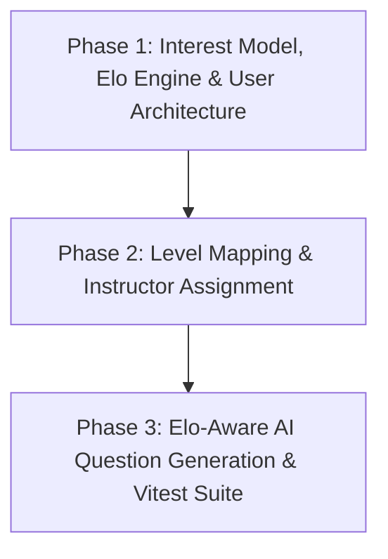

# Quimora — Master Roadmap (Layer 4)

> **Document Type:** Layer 4 Unified Backlog & Single Source of Truth  
> **Replaces:** Embedded roadmaps in `README.md` and outdated backlog files  
> **Last Updated:** 2026-09-28  

---

## 🟢 V1 Shipped Baseline (Completed & Stable)

- [x] **Authentication & Role Authorization**:
  - [x] Registration & Password hashing with Bcrypt.
  - [x] Login & JWT Token issuance with role guards (`user`/`student`, `instructor`, `admin`).
  - [x] Forgot Password flow via secure **6-Digit Email OTP** (Nodemailer, 10-min expiration).
- [x] **Core Database Models**:
  - [x] `User`, `Quiz`, `Question`, `QuizAttempt` Mongoose schemas wired & tested.
- [x] **Backend Integration Test Suite**:
  - [x] Automated test suites in `backend/tests/` using Vitest (`npm run test`).
- [x] **Groq AI Integration**:
  - [x] AI Question generator (`/api/v1/instructor/ai/generate-questions`) powered by Groq SDK.
  - [x] AI Quiz Description generator (`/api/v1/instructor/ai/generate-description`).
- [x] **Instructor Suite & Analytics**:
  - [x] Bulk CSV & JSON Question Importer (`BulkImportModal.jsx` and `/bulk` endpoint).
  - [x] Student Submissions inspection & Leaderboard CSV export.
  - [x] Complete Student Roster & Analytics page (`/instructor/students`) with graphical charts (Recharts).

---

## 🟡 V2 Shipped Scope (Completed & Verified)

- [x] **Automated Vitest Test Runner**: Wired in `backend/package.json` (`npm run test`).
- [x] **Server-Validated Timed Quiz Engine**:
  - [x] Backend session `startedAt` and duration calculation baseline (`createAttemptSession`).
  - [x] Exact server `remainingTimeSeconds` returned in session initialization payload.
  - [x] 15-second server grace buffer enforcement before marking session as `'abandoned'`.
  - [x] Student pre-quiz eligibility check endpoint (`GET /api/v1/student/quiz/:quizId/eligibility`).
  - [x] Automated Vitest coverage in `backend/tests/02_student_role.test.js`.
- [x] **Admin Control Suite**:
  - [x] System metrics summary endpoint & UI panel (total users, active quizzes, platform pass rates).
  - [x] User role elevation (`user` ↔ `instructor`) and account suspension toggle.
- [x] **Media & Image Uploads**:
  - [x] Question image attachments & User Avatar upload UI powered by ImageKit SDK.
- [x] **Docker & Redis In-Memory Caching**:
  - [x] Redis 7 container service in `docker-compose.yml` + `ioredis` backend integration (`redis.js`) with automatic DB fallback.
- [x] **UX Polish**:
  - [x] Mobile-responsive quiz taking interface optimization (`TakeExamPage.jsx`).
  - [x] Dynamic dark/light theme consistency across instructor and student views.
  - [x] 1-Click Quiz Clone / Duplication (`POST /api/v1/quizzes/:quizId/clone`).

---

## 🔵 V3 Planned Scope (Interest-Driven Adaptive Engine — Current Target)

### 🎯 V3 Objective
Build an **Interest-Driven Adaptive Assessment Engine** for Quimora that dynamically tailors quiz experiences to student skill levels via Elo ratings ($K=32$), maps skill progression to clear performance tiers, enforces explicit instructor assignments with student consent, and provides privacy-preserving analytics.

### 🌟 Core V3 Features
1. **Interest Selection & Quiz Filtering**:
   - Students pick topic interests/tags upon onboarding or profile customization.
   - Quiz catalog dynamically filters and highlights quizzes aligned with chosen interests.
   - Voluntary attempt flow without forced enrollment.
2. **Elo-Based Adaptive Difficulty Engine**:
   - Dynamic Elo rating formula calculated per student interest domain ($K = 32$).
   - Correct responses elevate student Elo and lower question difficulty; incorrect responses lower student Elo and elevate question difficulty.
3. **Level Mapping (Beginner → Expert)**:
   - Automated rank classification based on fixed Elo score thresholds:
     - **Beginner**: $0 - 1000$ Elo
     - **Learner**: $1000 - 1200$ Elo
     - **Intermediate**: $1200 - 1400$ Elo
     - **Advanced**: $1400 - 1600$ Elo
     - **Master**: $1600 - 1800$ Elo
     - **Expert**: $1800+$ Elo
4. **Instructor Assignment (1 Quiz = 1 Instructor)**:
   - Strict assignment mapping where each quiz is linked to one primary instructor via `QuizAssignment`.
   - Instructors manage multiple quizzes while maintaining clean ownership boundaries.
5. **Student Consent & Instructor Transparency**:
   - Pre-quiz modal displays instructor name, bio, expertise, and rating.
   - Student explicitly consents before initiating the quiz attempt (`POST /api/v1/student/quiz/:quizId/consent`).
6. **Privacy-Preserving Instructor Visibility**:
   - Instructors access full detailed breakdown (student names, answers, attempt metrics) for their assigned quizzes.
   - Cross-instructor quiz metrics display anonymized aggregate statistics only to protect student privacy.

### 📅 Implementation Phases

- **Phase 1: Interest Model, Elo Engine & User Architecture (In Progress)**:
  - Models: `Interest`, `EloRating`, `StudentProfile`, `InstructorProfile`.
  - Services: `eloEngine.service.js` ($K=32$), `user.service.js`, `studentProfile.service.js`, `instructorProfile.service.js`.
  - Scripts: `reset_v3_data.js`, `seed_v3_interests.js`, `seed_v3_levels.js`, `seed_admin.js`.
  - Interest selection UI on student dashboard and quiz filter bar.
- **Phase 2: Level Mapping & Instructor Assignment**:
  - Models: `Level`, `QuizAssignment`.
  - Services: `levelMapping.service.js` with Redis caching.
  - UI: Level tier badges, rank progress card, pre-quiz instructor consent modal.
  - Enforce instructor data isolation middleware (`scopeInstructorAnalytics`).
- **Phase 3: Elo-Aware AI Question Generation & Vitest Suites**:
  - Extend Groq AI question generator with target student Elo level / difficulty band.
  - End-to-end integration testing in Vitest (`05_v3_adaptive_engine.test.js`).

### 🚫 Out of Scope for V3
The following items belong to future releases and are explicitly excluded from V3 planning:
- Native Mobile Application (React Native)
- Advanced AI Video/Webcam Proctoring
- Enterprise Multi-Tenancy & Workspace Isolation

---

## 🔮 Future Scope (V4/V5)

> *Future is bright. Once V3 is reached, V4/V5 will be planned. For now, focus on V3.*

