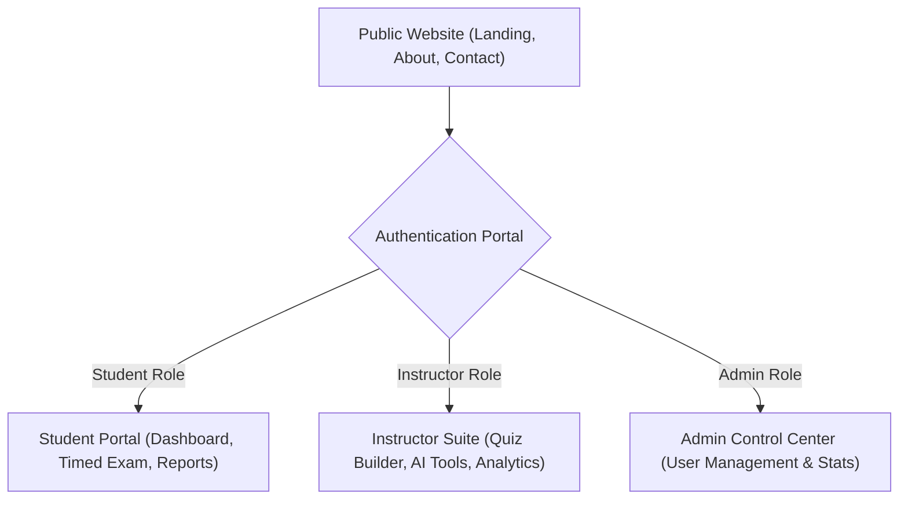

<p align="center">
  
</p>

<p align="center">
  <strong>The Next-Generation Interactive Assessment & Adaptive E-Learning Frontend</strong>
</p>

<p align="center">
  <a href="https://quimora-rho.vercel.app" target="_blank">
    
  </a>
  
  
  
  
  
</p>

---

## 🌐 Live Production Deployment

The frontend client is continuously deployed and accessible globally on Vercel:

> 🚀 **Production URL:** [https://quimora-rho.vercel.app](https://quimora-rho.vercel.app)  
> 🔗 **Backend API:** [https://quimora.onrender.com/api/v1](https://quimora.onrender.com/api/v1) (Render)

---

## 🌟 Overview & Key Portals

Quimora Frontend is a high-performance Single Page Application (SPA) providing role-tailored dashboards and secure exam experiences for students, instructors, and administrators.



---

## ✨ Features by Role

### 🎓 1. Student Learning Portal
- **Interactive Dashboard:** Quick overview of assigned quizzes, attempt statistics, average score, and skill progression.
- **Quiz Discovery:** Browse and search quizzes with category filters, difficulty tags, and time duration estimates.
- **Proctored Fullscreen Exam Mode (`TakeExamPage.jsx`):**
  - **Live Server Timer:** Real-time synchronized countdown with authoritative server verification.
  - **Cheating Deterrence:** Fullscreen overlay lock, tab-switching tracking, and disabled copy-paste triggers.
  - **Navigation Drawer:** Question jump palette, flagged-for-review status, and instant question status badges.
- **Instant Result & Comprehensive Reports:**
  - Instant scorecard with score breakdown, passing criteria indicator, and negative marking penalty calculation.
  - Detailed Question-by-Question report (`StudentFullReportPage.jsx`) with correct answer reveals and explanations.
- **Attempt History:** Filterable historical log of past attempts, scores, and downloadable performance insights.

### 👨‍🏫 2. Instructor Suite & AI Tools
- **Instructor Dashboard:** Real-time metrics on total authored quizzes, enrolled students, attempt counts, and average pass rate.
- **Quiz Authoring & Cloning:** Create quizzes manually or 1-click clone existing quizzes with questions intact.
- **Groq AI Assistant:**
  - Instant AI Question Generator (`/instructor/ai/generate-questions`) for producing calibrated multiple-choice questions.
  - Automatic Quiz Description Generator for SEO and course engagement.
- **Bulk Importers:** Upload hundreds of questions in seconds using validated CSV or JSON formats.
- **Student Roster & Visual Analytics:**
  - Detailed roster of all students attempting quizzes.
  - 7-day attempt trends and score distributions powered by **Recharts**.
  - CSV Leaderboard Export for offline grading.

### 👑 3. Administrator Control Center
- **System Overview Panel:** High-level metrics tracking total registered accounts, active quizzes, and platform performance.
- **User Management Table:** Paginated user directory with search and role filtering (`student`, `instructor`, `admin`).
- **Role Elevation:** Promote students to instructors or update user privileges with immediate effect.
- **Instant Account Suspension:** 1-click security suspension with administrative safeguards preventing last-admin lockouts.

---

## 🗺️ Page & Route Mapping

| Route | View Component | Guard / Access | Description |
| :--- | :--- | :--- | :--- |
| `/` | `Navigate` | Public | Intelligent redirect based on user authentication and role |
| `/public` | `LandingPage.jsx` | Public | Hero section, interactive topic explorer, testimonials |
| `/about` | `AboutUs.jsx` | Public | Mission statement, team, platform philosophy |
| `/contact` | `ContactUs.jsx` | Public | Contact and support request form |
| `/login` | `LoginPage.jsx` | Guest | User authentication with email/password |
| `/register` | `RegisterPage.jsx` | Guest | Student/User onboarding |
| `/student` | `StudentDashboardPage.jsx` | `Protected (user)` | Student portal dashboard and statistics |
| `/student/quizzes` | `QuizListPage.jsx` | `Protected (user)` | Browse and search available quizzes |
| `/student/quiz/start` | `TakeExamPage.jsx` | `Protected (user)` | Secure, fullscreen timed quiz taking session |
| `/student/quiz/results` | `SingleAttemptResultPage.jsx` | `Protected (user)` | Instant score and attempt outcome |
| `/student/attempts/:id/report` | `StudentFullReportPage.jsx` | `Protected (user)` | Full question-by-question review |
| `/instructor` | `InstructorDashboardPage.jsx` | `Protected (instructor)` | Instructor metrics and quick actions |
| `/instructor/quizzes` | `InstructorQuizListPage.jsx` | `Protected (instructor)` | Manage authored quizzes & bulk imports |
| `/instructor/students` | `InstructorStudentListPage.jsx` | `Protected (instructor)` | Student roster, Recharts analytics, CSV export |
| `/admin` | `AdminDashboardPage.jsx` | `Protected (admin)` | Global system metrics & user administration |
| `/profile` | `Profile.jsx` | Authenticated | User profile, avatar management, password reset |

---

## 🛠️ Technology Stack

| Domain | Technology | Purpose |
| :--- | :--- | :--- |
| **Framework** | **React 19** | Component-driven UI with modern concurrent features |
| **Build Tool** | **Vite 8** | Sub-second Hot Module Replacement (HMR) and optimized rollup bundle |
| **Styling** | **Tailwind CSS v4** | Next-generation CSS framework with CSS variables design tokens |
| **State Management** | **Zustand** | Lightweight, reactive global stores (`authStore`, `quizStore`) |
| **HTTP Client** | **Axios** | Interceptor-driven client with automated JWT injection and cache-busting headers |
| **Data Visualization** | **Recharts** | Interactive SVG charts for student trends and instructor analytics |
| **Motion & Micro-interactions** | **Framer Motion** | Fluid animations, card reveals, and layout transitions |
| **Icons** | **Lucide React** | Modern, unified SVG icon system |
| **Notifications** | **React Hot Toast** | Crisp, customizable toast notifications |

---

## 📂 Project Architecture

```
frontend/src/
├── api/             # Axios instance & global interceptors
│   └── axiosClient.js
├── assets/          # Static logos, branded artwork, and vectors
│   ├── logo.png     # Circular Q badge
│   └── quimora.png  # Full Quimora brand wordmark
├── components/      # Reusable design system elements
│   ├── navigation/  # Navbar, Sidebar, Header, Footer
│   ├── ui/          # Modals, Buttons, Input fields, Badges
│   └── feedback/    # Loaders, error boundaries, empty states
├── features/        # Domain-driven feature modules
│   ├── auth/        # Auth state store, login/register forms
│   ├── student/     # Exam session components, timer hook, question drawers
│   ├── instructor/  # Quiz creation modals, AI generator dialogs, bulk uploaders
│   └── admin/       # User management tables, stats cards
├── pages/           # Routed page views (public, student, instructor, admin)
├── routes/          # Declarative React Router setup with RBAC guards
├── store/           # Zustand stores for global application state
└── utils/           # Time formatters, score calculators, theme hooks
```

---

## ⚙️ Environment Configuration

Create a `.env` file inside the `frontend/` directory:

```env
# Backend API Base URL
VITE_API_URL=http://localhost:5000/api/v2

# ImageKit CDN Endpoint (for media assets & avatars)
VITE_IMAGEKIT_URL_ENDPOINT=https://ik.imagekit.io/wlikbydy9
```

> **Production note:** When deployed to Vercel, `VITE_API_URL` points to the hosted Render server (`https://quimora.onrender.com/api/v1` or `/api/v2`).

---

## 🚀 Getting Started

### 1. Prerequisites
- **Node.js**: v18.0.0 or higher
- **npm** or **pnpm**

### 2. Installation
```bash
# Navigate to frontend folder
cd frontend

# Install dependencies
npm install
```

### 3. Development Server
```bash
npm run dev
```
Open [http://localhost:5173](http://localhost:5173) in your browser.

### 4. Production Build
```bash
# Type check and build bundle
npm run build

# Preview production build locally
npm run preview
```

---

## 📚 Related Project Documents

- 📋 **Product Requirements**: [`prd.md`](file:///d:/quimora/prd.md)
- 🚀 **Live Progress Tracker**: [`progress.md`](file:///d:/quimora/progress.md)
- 📐 **System Architecture**: [`docs/ARCHITECTURE.md`](file:///d:/quimora/docs/ARCHITECTURE.md)
- 🔌 **API Reference**: [`docs/API_REFERENCE.md`](file:///d:/quimora/docs/API_REFERENCE.md)
- 🗺️ **Master Roadmap**: [`docs/MASTER_ROADMAP.md`](file:///d:/quimora/docs/MASTER_ROADMAP.md)
